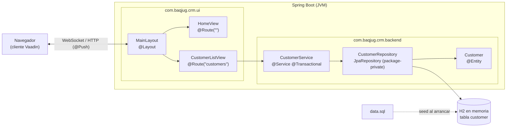
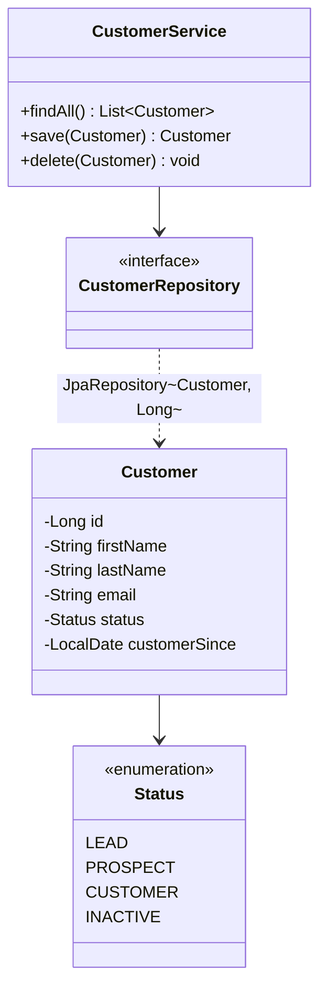
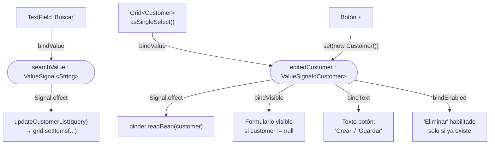
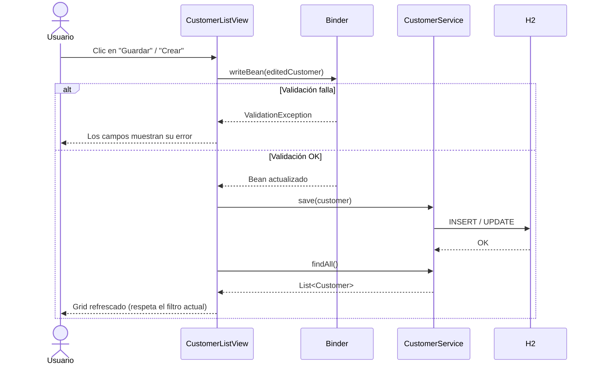

# CRM Interno — Vaadin Flow + Spring Boot

CRM mínimo para gestionar clientes, construido 100 % en Java con **Vaadin Flow 25** sobre **Spring Boot 4**. Sin HTML, sin JavaScript, sin API REST intermedia: la UI vive en el servidor y llama directamente a los servicios de Spring.

El proyecto está pensado como material de taller (BaqJUG): cada commit agrega una capacidad concreta, así que el historial de git funciona como una guía paso a paso.

---

## Stack

| Pieza            | Versión / detalle                                  |
|------------------|----------------------------------------------------|
| Java             | 25                                                 |
| Spring Boot      | 4.1.2                                              |
| Vaadin Flow      | 25.3.5 (tema **Aura**, modo oscuro, `@Push`)       |
| Persistencia     | Spring Data JPA + **H2 en memoria**                |
| Build            | Maven Wrapper (`./mvnw`)                           |
| Contenedor       | Dockerfile multi-stage (Temurin 25 JRE Alpine)     |

---

## Funcionalidades

- **Shell de la aplicación** con `AppLayout` y navegación lateral (`SideNav`): *Inicio* y *Clientes*.
- **Grid de clientes** con columnas nombre, apellido, correo, estado y fecha de alta (nombre ordenable).
- **Búsqueda reactiva** con *signals*: filtra por nombre, apellido, correo o estado mientras escribes (`ValueChangeMode.LAZY`).
- **Formulario de detalle** enlazado a la selección del grid mediante `Binder`, con validaciones de campos obligatorios.
- **Edición con buffer**: los cambios solo se aplican al pulsar *Guardar*; *Descartar* restaura los valores originales.
- **Crear y eliminar** clientes; la eliminación pide confirmación con `ConfirmDialog`.
- **Datos de ejemplo** cargados al arrancar desde `data.sql`.

---

## Arquitectura

Dos paquetes con responsabilidades claras: `ui` (vistas Vaadin) y `backend` (dominio + persistencia). La UI solo conoce `CustomerService`; el repositorio es *package-private* y no se puede usar desde las vistas.



### Modelo de dominio



`Customer.equals()` compara por `id` y `hashCode()` es constante por clase: es el patrón recomendado para entidades JPA con id generado, y permite que el grid reconozca la misma fila antes y después de guardar.

---

## Flujo reactivo de la vista de clientes

`CustomerListView` usa dos `ValueSignal` como única fuente de verdad. Los componentes se enlazan a ellas y los `Signal.effect` se reejecutan solos cuando cambian.



### Guardar un cliente



---

## Estructura del proyecto

```
src/main/java/com/baqjug/crm
├── Application.java              # Punto de entrada Spring Boot
├── AppShell.java                 # Tema Aura, modo oscuro, @Push, styles.css
├── backend
│   ├── Customer.java             # Entidad JPA
│   ├── CustomerRepository.java   # JpaRepository (package-private)
│   ├── CustomerService.java      # API transaccional para la UI
│   └── Status.java               # LEAD | PROSPECT | CUSTOMER | INACTIVE
└── ui
    ├── MainLayout.java           # AppLayout + SideNav
    ├── HomeView.java             # Ruta "/"
    └── CustomerListView.java     # Ruta "/customers"

src/main/resources
├── application.properties
├── data.sql                      # Datos de ejemplo
└── META-INF/resources/styles.css # Variables del tema Aura
```

---

## Cómo ejecutarlo

Requisitos: **JDK 25**. Maven no hace falta, el wrapper lo descarga.

```bash
./mvnw spring-boot:run
```

Abre http://localhost:8080 (el navegador se abre solo en modo desarrollo). El primer arranque tarda más porque descarga dependencias y prepara el frontend.

Notas:

- El puerto se cambia con la variable `PORT` (por defecto `8080`).
- La base de datos es **H2 en memoria**: los cambios se pierden al reiniciar y `data.sql` vuelve a sembrar los clientes de ejemplo.
- Para recarga en caliente de código Java, arranca desde el IDE con el plugin de Vaadin (*Debug using Hotswap Agent*).

### Build de producción

```bash
./mvnw package
```

```bash
java -jar target/crm-vaadin-1.0-SNAPSHOT.jar
```

### Docker

```bash
docker build -t crm-vaadin:latest .
```

```bash
docker run -p 8080:8080 -m 2g crm-vaadin:latest
```

La imagen arranca con `--spring.profiles.active=prod` y reserva el 75 % de la memoria del contenedor para el heap, que es donde vive el estado de la UI de cada usuario.

---

## Licencia

Dominio público ([Unlicense](LICENSE.md)).
